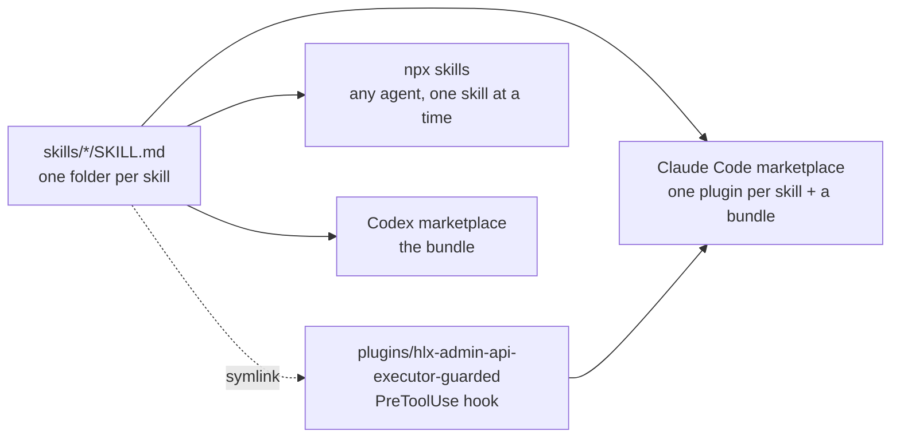

# ai-builder-kit

[](https://github.com/jackzhaojin/ai-builder-kit/actions/workflows/validate.yml)
[](LICENSE)

A collection of skills, plugins, and hooks for AI coding agents. Works as a [Claude Code plugin marketplace](https://code.claude.com/docs/en/plugin-marketplaces), a [Codex plugin marketplace](https://developers.openai.com/codex/plugins), and a plain skills repo for `npx skills`. Every skill is a portable `SKILL.md`, so the same folder works in Claude Code, Codex, and any agent that follows the [Agent Skills spec](https://agentskills.io).



One source of truth: every channel reads the same `skills/` folder, and the hook plugin pulls its skill in through a symlink instead of a copy.

## Available Skills

| Skill | Last Modified | Description |
|-------|--------------|-------------|
| [ai-knowledge-harvester](skills/ai-knowledge-harvester/) | 2026-04-12 | Harvest AI docs, prompt logs and agent configs from repos or pasted AI exports into a private knowledge repo with a project-first taxonomy |
| [branded-pptx](skills/branded-pptx/) | 2026-10-25 | Create branded PowerPoint decks from a template: analyzes themes, slide masters and layouts (shape dimensions, text capacity, visual data), then generates slides that match, in timestamped run folders. **Requires**: the [pptx](https://github.com/anthropics/skills) skill, `uv` |
| [chat-conversation-logger](skills/chat-conversation-logger/) | 2026-05-24 | Log Claude.ai chat conversations as `prompt-log-YYYY-MM-DD-{N}-{slug}.md` files with verbatim prompts, attachment metadata and a per-turn tool record |
| [competing-pr-triage](skills/competing-pr-triage/) | 2026-04-11 | Compare two PRs or branches that different agents produced for the same goal and recommend one, with a per-requirement verdict table, a scope audit and a follow-up plan |
| [conversation-logger](skills/conversation-logger/) | 2026-05-24 | Log Claude Code and Codex sessions as `prompt-log-YYYY-MM-DD-{N}-{slug}.md` files. The stage counter `{N}` keeps a folder listing in chronological order, and a new day starts a new file |
| [drawio](skills/drawio/) | 2026-04-27 | Generate `.drawio` XML diagrams in Jack's brand style (swimlane frames, 4-color semantic palette, cylinders for data stores, orthogonal edges, dashed lines only for responses). Multiple-choice interview first, then a render-view-fix loop with versioned iterations. Ships worked examples and an evals harness |
| [excalidraw](skills/excalidraw/) | 2026-09-13 | Generate `.excalidraw` diagrams in Jack's brand style (hand-drawn roughness, Nunito, 7-color semantic palette, frames for grouping) with a mandatory render-view-fix loop. Ships six worked examples with PNG previews and an evals harness. **Requires**: `uv` plus a one-time `uv run --with playwright playwright install chromium` |
| [hlx-admin-api-executor](skills/hlx-admin-api-executor/) | 2026-10-25 | AEM Edge Delivery Services Admin API executor: plan the calls, run one request at a time with human review, and log every request and response. Soft guardrails only; the guarded plugin below enforces them |
| [jack-git-commit](skills/jack-git-commit/) | 2026-05-15 | Conventional Commits with traceable metadata footers (Goal, Step, Worker, Skill, Tools), so `git log` works as a queryable work ledger. Never pushes |
| [playwright-demo-video](skills/playwright-demo-video/) | 2026-06-11 | Generate polished demo MP4s from Playwright specs: on-screen captions, ElevenLabs voiceover synced to timestamps, freeze-frame merge and background music. Auto-discover mode scans a project and writes the demo spec. **Requires**: ffmpeg, Node.js 18+, Playwright in the target project, an ElevenLabs API key for voiceover |
| [podcast-slides-video](skills/podcast-slides-video/) | 2026-10-25 | Build a YouTube-ready MP4 from narrated audio (a NotebookLM overview, a recorded talk) plus a slide deck (PDF or PPTX), with slide changes cut to the transcript. Produces the MP4, an auditable cue sheet, a validation contact sheet and a YouTube chapter list. **Requires**: ffmpeg/ffprobe, `uv` (MLX Whisper on Apple Silicon, validator dependencies), poppler, LibreOffice for PPTX input |

## Available Plugins

| Plugin | Last Modified | Description |
|--------|--------------|-------------|
| [hlx-admin-api-executor-guarded](plugins/hlx-admin-api-executor-guarded/) | 2026-10-25 | The `hlx-admin-api-executor` skill plus a PreToolUse hook that asks before any `curl` write to `admin.hlx.page` or `api.aem.live`. Claude Code only |
| [ai-builder-kit](.claude-plugin/marketplace.json) | 2026-09-13 | Every skill above as one plugin, for Claude Code (`ai-builder-kit@ai-builder-kit`) and Codex (`.agents/plugins/marketplace.json`). Skills only, no hooks |

## Getting Started

Pick one path. They all read the same `skills/` folder.

### Option A: `npx skills` (any agent, one skill at a time)

```bash
npx skills add jackzhaojin/ai-builder-kit --list                       # see what is available
npx skills add jackzhaojin/ai-builder-kit --skill excalidraw            # into this project
npx skills add jackzhaojin/ai-builder-kit --skill excalidraw -g -a claude-code codex   # global, Claude Code + Codex
npx skills add jackzhaojin/ai-builder-kit -g -y                         # everything, global
npx skills update -g -y                                                 # pull updates later
```

Codex and OpenCode read `~/.agents/skills` directly, so a global install shows up in both with no extra step.

### Option B: Claude Code plugin marketplace

Every skill is a plugin of the same name, and `ai-builder-kit` is a bundle of all of them. Install the bundle or individual skills, not both, or the skills load twice.

```bash
claude plugin marketplace add jackzhaojin/ai-builder-kit
claude plugin install excalidraw@ai-builder-kit                # one skill
claude plugin install ai-builder-kit@ai-builder-kit            # every skill
claude plugin install hlx-admin-api-executor-guarded@ai-builder-kit   # skill + enforced hook
```

Or in one step from a session (Claude Code 2.1.275 or later): `/plugin install excalidraw --marketplace jackzhaojin/ai-builder-kit`. The same marketplace can be pinned for a team in a project's `.claude/settings.json`:

```json
{
  "extraKnownMarketplaces": {
    "ai-builder-kit": {
      "source": { "source": "github", "repo": "jackzhaojin/ai-builder-kit" }
    }
  }
}
```

### Option C: Codex and the ChatGPT desktop app

The repo ships `.agents/plugins/marketplace.json` with one plugin, `ai-builder-kit`, that bundles all skills (manifest in `.codex-plugin/plugin.json`).

```bash
codex plugin marketplace add jackzhaojin/ai-builder-kit
```

Then restart the ChatGPT desktop app, open the Plugins Directory, choose the **AI Builder Kit** marketplace, and install. For single skills in Codex, use Option A with `-a codex`.

## Keeping it up to date

Skill plugins carry no pinned version, so Claude Code keys updates on the commit SHA and every push to `main` that touches a skill is an update. The guarded plugin pins a version in its `plugin.json` and updates when that number moves. Pull updates with whichever path you installed from:

| Installed with | Update with |
|----------------|-------------|
| `npx skills` | `npx skills update -g -y` (global) or `npx skills update -p -y` (inside a project) |
| Claude Code marketplace | `/plugin update` in a session, or `claude plugin marketplace update ai-builder-kit` followed by `claude plugin update <name>@ai-builder-kit` |
| Codex marketplace | `codex plugin marketplace upgrade ai-builder-kit`, or reinstall from the Plugins Directory in the desktop app |

## Repo layout

| Path | Purpose |
|------|---------|
| `skills/<name>/SKILL.md` | The skills. Flat layout, one folder per skill |
| `plugins/<name>/` | Plugins that add hooks (Claude Code only). Skills inside are symlinks to `skills/` |
| `.claude-plugin/marketplace.json` | Claude Code marketplace: one entry per skill, the bundle, and the hook plugins |
| `.agents/plugins/marketplace.json` | Codex marketplace: the bundle |
| `.codex-plugin/plugin.json` | Codex manifest for the bundle (`"skills": "./skills/"`) |
| `plugin.json` | The same bundle described in the portable [Agent Plugins](https://agent-plugins.org) format |
| `scripts/check-repo.mjs` | Convention checks that `claude plugin validate` does not cover |
| `.github/workflows/validate.yml` | CI: the convention checks, the Claude Code validator and ShellCheck on every push and PR |

## Developing

Rules for adding or changing a skill live in [CLAUDE.md](CLAUDE.md) (`AGENTS.md` is a symlink to it, so Codex reads the same rules). Before committing:

```bash
node scripts/check-repo.mjs
claude plugin validate .claude-plugin/marketplace.json --strict
claude plugin validate skills --strict
```

## License

[Apache-2.0](LICENSE)
